# KT Studio

> **Beta.** KT Studio works end to end and has been tested on four sample projects,
> but settings and commands can still change before 1.0. Please
> [report problems or ideas](https://github.com/buminduyasith/kt-studio/issues).

**KT Studio makes a knowledge-transfer (KT) video of a feature for you.**

You finished a feature. Now you need to explain it to QA, a scrum master or a new teammate. Usually
that means a meeting, or recording your screen and talking. KT Studio does it for you: you type one
command, and you get a narrated video made from your **real app** and your **real code**.

It is a plugin for [Claude Code](https://claude.com/claude-code).

## What you get

Each video has two parts:

- **Part A, how to use it:** your real app in a browser. The mouse moves, types and clicks, and the
  voice explains each step. Every click happens on the word that names it.
- **Part B, how it works:** first the big picture, in motion. The parts of your system appear one by
  one with their jobs, then your example request travels between them: what is sent, what is saved,
  what happens when it fails. Then it zooms into each part and opens the real files in a VS Code style
  editor, one idea at a time, with a small map in the corner that says where you are.

Every video opens with an intro card (what the feature is, what you will learn, the chapters, who
built it) and closes with an outro card (three things to remember, next steps, who to ask). You pick
which names are shown, or none. You also get subtitles and chapters. The voice is made **on your computer**, so your code and
narration are never sent to a voice service.


## Install

In Claude Code, type:

```
/plugin marketplace add buminduyasith/kt-studio
/plugin install kt-studio@kt-studio
```

This always installs the **newest release**. To check which version you have, run
`claude plugin list`. To update later, see [Versions and updates](#versions-and-updates).

**For your whole team.** Commit this as `.claude/settings.json` in your project (or merge it into the
one you have). It turns KT Studio on for everyone who opens the project in Claude Code and trusts the
folder, but it does not download it to their computer. To stay on one release, add `"ref": "<tag>"`
next to `"repo"`.

```json
{
  "extraKnownMarketplaces": {
    "kt-studio": {
      "source": { "source": "github", "repo": "buminduyasith/kt-studio" }
    }
  },
  "enabledPlugins": {
    "kt-studio@kt-studio": true
  }
}
```

Each teammate then installs it once, in a terminal in the project folder (until they do, `/plugin`
shows that KT Studio is enabled in the project settings but not installed):

```bash
claude plugin install kt-studio@kt-studio --scope project
```

Then they run `/kt-studio:init` once on their computer. It downloads the recorder and the voice, and
finds the settings you already committed in `.kt-studio/`.

You need macOS or Linux, Node.js 20+, Python 3.9+, git, curl, ffmpeg and about 1 GB of free disk space.
You don't have to check this yourself: the first step below checks everything and tells you what is
missing.

## How to use it

**1. Set up your project (once).** Open Claude Code in your project folder and type:

```
/kt-studio:init
```

It checks your computer, looks at your project and its docs, asks a few questions (for example,
which services you have, what each one is for and where each one runs, and what the research should
read besides the code: docs folders, other folders, wiki links, or only the code), and saves your
answers in a `.kt-studio/` folder. Then it installs the recorder. This takes 2 to 5 minutes, one time only.

**2. Make a video.** Type the command and the name of a feature:

```
/kt-studio:make order-refunds
```

You can add instructions in plain words:

```
/kt-studio:make order-refunds "on QA, for testers, only the partial refund, skip the frontend code"
```

| Command | What it does |
|---|---|
| `/kt-studio:make <feature> [instructions]` | Makes a video of a feature |
| `/kt-studio:init` | Sets up your project. The only command that downloads anything (the recorder, up to 1 GB the first time on a computer) |
| `/kt-studio:update <feature> [change]` | Changes a video you already have |
| `/kt-studio:doctor` | Checks that everything is ready and says how to fix what is not |

You can also just ask in your own words, for example "make a KT video of order refunds for QA".

**It asks a few quick questions, with the best answer first.** Who the video is for, what to show
(screens, code or both), which environment, and what to read besides the code (your usual sources, code
only, or a spec or link you add for this feature). After reading the code, it asks how deep to go and which
flows to show, with answers taken from your code. Anything your request already says is not asked.
It remembers the answers: each feature keeps them in its own folder, and the answers your team picks
most often become the recommended ones. The first video in a project asks the most; later ones ask
less, and a question stops once the same answer was picked 3 times in a row.

**3. Check the storyboard.** Before anything is recorded, you get a storyboard: a page with every
scene, what is on screen and every line the voice will say. Ask for changes in the chat. **Nothing is
recorded until you say it is OK.**

**4. Get your video.** KT Studio records the app and the code tour, checks the result, and gives you
the finished videos.



## What happens during a run

| Step | What it does |
|---|---|
| Check | Makes sure the tools and settings are ready (under a second) |
| Research | Follows the feature from the button a user clicks to the data that is saved. Docs and comments are only leads: every fact is checked in the current code (or seen running) and points to a file and line, and stale docs are flagged, never repeated |
| Storyboard | Shows you every scene and every spoken line. **You approve it first** |
| Rehearse | Makes the voice and does a practice run where nothing can be saved or changed |
| Record | If the recording would save or change data in a shared system, it asks you first. Then it records |
| Check | Looks for problems: blank frames, a late voice, a click that misses its word. Only the bad parts are recorded again |
| Deliver | Gives you the videos with subtitles and chapters |
| Clean up | Closes every browser and server it opened |

## Works with any project

- **Any language.** Python, JavaScript, TypeScript, Java, Go, Rust and more. A project can be one repo,
  several repos, or folders of one big repo.
- **No screens?** For a command-line tool, a library or an API, the video shows real commands in a
  terminal and what they print.
- **Short or deep.** A small feature gets a short 2 to 4 minute overview. A big feature, or a request
  like "explain the retries in detail", gets a longer video with a chapter for each part.
- **Review on your computer.** Set `review: local` in `.kt-studio/config.yml` to open the storyboard as a file
  on your computer.

Want to try it first? The [`samples/`](samples/) folder has four small projects: a web app with a
login, Java and TypeScript services, a Go API, and a Rust command-line tool.

## Change a video later: `/kt-studio:update`

Need to fix one sentence, add a scene, or show code that changed? You don't have to record the whole
video again:

```
/kt-studio:update order-refunds "in scene B3-02, say the limit is ten working days"
/kt-studio:update order-refunds "add a scene after B3-09 about the outbox"
/kt-studio:update order-refunds        # the code changed: find the scenes that are out of date
```

KT Studio updates the storyboard and marks what changed for you to check. Then it records **only the
changed scenes** and puts them into the video. You can't see where the new part starts: no fade, no
jump. One changed sentence takes about 45 seconds instead of about 4.5 minutes. The old version is
kept.

## How the voice and the clicks stay together


1. The voice is made **before** recording, so KT Studio knows when each word is spoken.
2. Each click or key press waits for the word that names it, like "Book".
3. The mouse starts moving early, so the click lands just after the word.
4. After recording, a check fails any click that comes too late, and any part where the picture falls
   behind the voice.

In tests, every click landed 0.07 to 0.21 seconds after its word.

## Your settings: the `.kt-studio` folder

`/kt-studio:init` puts everything KT Studio keeps for your project in one folder, so it is not mixed
with your own files:

```
<project>/
└── .kt-studio/
    ├── config.yml             settings: which repos and branches to show, which docs to read first, which voice
    ├── instructions.md        your rules in plain words, your services and where each one runs
    ├── learned.yml            the answers your team picked, so later videos ask less
    ├── .gitignore             git keeps your settings and answers, nothing else
    ├── runtime/               the recorder, the offline voice, this run's logins (not in git)
    └── features/
        └── order-refunds/         one folder per feature
            ├── feature.yml        this feature's answers: who it is for, what to show, how deep
            └── runs/
                └── 2026-10-13-order-refunds/   one folder per video (not in git)
                    ├── 1-research/        what it found, with file and line numbers
                    ├── 2-storyboard/      the storyboard and screenshots
                    ├── 3-scripts/         the recording scripts
                    ├── 4-checks/          check reports
                    └── 5-videos/          the finished videos and subtitles
```

The `.kt-studio/` folder sits next to your `.claude/` folder and `CLAUDE.md`. Commit `config.yml`,
`instructions.md`, `learned.yml` and each `feature.yml`: then your whole team shares the answers.
Change `config.yml` and `instructions.md`, not the plugin. Your rules come
first, except the safety rules. [All settings](plugins/kt-studio/skills/kt-studio/references/config.md)

**Your services and where they run.** Most projects have several services, and each one can run in
several environments (on your computer, dev, QA), or only in some. `instructions.md` holds two small
tables:

```
## Services

| Service      | What it is for                        | Talks to  | Login           |
| ------------ | ------------------------------------- | --------- | --------------- |
| Shop         | Where customers browse, pay and track orders | Orders API | Test account  |
| Orders API   | Takes and stores orders, sends refunds       | Postgres   | No screens    |
| Help center  | Where customers read help articles           | Orders API | Its own login |

## Addresses

| Service      | local                 | dev                         | qa                         |
| ------------ | --------------------- | --------------------------- | -------------------------- |
| Shop         | http://localhost:3000 | https://shop.dev.acme.test  | https://shop.qa.acme.test  |
| Help center  |                       | https://help.dev.acme.test  |                            |
```

Each video finds its apps by itself: the address or environment in your request first ("on QA"),
then these tables, then CLAUDE.md and your docs, then an app it finds running on your computer. It
asks only when it can't tell. When it learns a new service, environment or address, it adds it to the
tables for next time. It never changes what you wrote.

**Logging in: KT Studio never logs in for you.** A third table in `instructions.md` says how people log
in to each service in each environment, and KT Studio follows it exactly:

```
## Logging in

| Service     | Environment | How    | The person runs              | Session file          |
| ----------- | ----------- | ------ | ---------------------------- | --------------------- |
| Shop        | local       | none   |                              |                       |
| Shop        | dev, qa     | script | `node tools/login.mjs {env}` | .auth-team/{env}.json |
| Help center | dev         | window |                              |                       |
```

- `none`: no login.
- `window`: KT Studio opens a browser window and you log in your usual way (password, SSO, 2FA, anything).
- `script`: your team's own login command. **You** run it when KT Studio asks; it never runs it. KT
  Studio then uses the session file it saved.

A script reads this table, not Claude's memory, and a recording will not start while an app that needs
a login has no valid session: it tells you what to do instead. A login KT Studio saved itself is
deleted when the run ends; your own session files are never touched. Never put a password in these
files.

## Versions and updates

KT Studio is in **beta** while its version starts with `0.`. Every release has a version number and
a git tag, and its GitHub release says what changed and whether you need to do anything.

**Get updates automatically (recommended).** Claude Code does not update plugins from community
marketplaces unless you ask it to. Turn it on once:
`/plugin` → **Marketplaces** → **kt-studio** → **Enable auto-update**.
Claude Code then looks for a new version within about ten minutes after you start using a session.

**Or update by hand.** In a terminal:

```bash
claude plugin marketplace update kt-studio
claude plugin update kt-studio@kt-studio
```

Then type `/reload-plugins` in Claude Code, or start a new session. The next time you make a video,
`/kt-studio:doctor` (and every video run) notices the new version and refreshes the recorder in your project by itself
(a few seconds, nothing is downloaded). If an update needs a new download, it asks you to run
`/kt-studio:init` first. Your settings files and your finished videos are not touched.

**Stay on one version.** To keep a version and skip updates, add the marketplace with that
version's tag:

```
/plugin marketplace add buminduyasith/kt-studio#<tag>
/plugin install kt-studio@kt-studio
```

**Go back to an older version.** Remove the marketplace (this also removes the plugin), then add it
again with the tag you want, as above:

```
/plugin marketplace remove kt-studio
```

## If something goes wrong

Type `/kt-studio:doctor`. It checks everything in about a second and tells you how to fix each
problem.

| Problem | Fix |
|---|---|
| Chromium won't start on Linux | In `.kt-studio/runtime`, run `npx playwright install-deps chromium` |
| "Session expired" | Log in again (in the window it opens, or your team's own way). Logins on real websites often last only an hour or two |
| "Run /kt-studio:init" after you reinstalled the plugin | Uninstalling deletes the shared recorder (Claude Code removes a plugin's data folder). `/kt-studio:init` downloads it again once; your settings and videos are untouched. To keep it, uninstall with `claude plugin uninstall kt-studio@kt-studio --keep-data` |
| "The app does not answer" | Start your app, or give the right address in your request |
| Port 8765 is busy | An old code tour is still running. The clean-up step stops it |
| A click lands late | The check names the line. Add a few words before the action, or pick another word for it |

Record one project at a time. Two recordings at once make the computer slow and the timing slips.

## Safety

- KT Studio never logs in for you and never types a password. You log in in a window it opens, or your
  team's own way.
- A run's login is kept in `.kt-studio/runtime/.auth/` (not in git) only until the run ends, then
  deleted. KT Studio deletes only the files it made there.
- If a recording would save or change data in a shared system, it asks you every time. Practice runs
  can't save anything.
- The code tour only reads your code from git. It never runs or changes it.

## For developers

```
kt-studio/
├── .claude-plugin/        the marketplace file
├── plugins/kt-studio/     the plugin, the only folder people get: four skills (make, init, update,
│                          doctor), their references, scripts and recorder files, and the evals
├── samples/               four test projects (not shipped)
└── docs/                  diagrams, the product video sources and the publishing guide (not shipped)
```

To test, check and publish the plugin, see [docs/publishing.md](docs/publishing.md).

## Thanks to these open-source projects

KT Studio stands on the work of these projects. Thank you to everyone who builds and maintains them.

**What the plugin uses when it records a video**

| Project | Licence | What KT Studio uses it for |
|---|---|---|
| [Argo](https://github.com/shreyaskarnik/argo) | MIT | Records the browser demos, times the voice, and exports videos with chapters and subtitles |
| [Playwright](https://playwright.dev) and [Chromium](https://www.chromium.org) | Apache-2.0, BSD | Drives and records the browser |
| [Kokoro-82M](https://huggingface.co/hexgrad/Kokoro-82M) and [kokoro-js](https://github.com/hexgrad/kokoro) | Apache-2.0 | The offline voice |
| [Transformers.js](https://github.com/huggingface/transformers.js) | Apache-2.0 | Runs the voice model (and the optional Whisper model) on your computer |
| [ONNX Runtime](https://github.com/microsoft/onnxruntime) | MIT | The engine under Transformers.js |
| [Whisper](https://github.com/openai/whisper) (`whisper-base.en`) | MIT | Optional: exact word times for the voice |
| [Shiki](https://shiki.style) | MIT | Colours the code like VS Code |
| [sharp](https://sharp.pixelplumbing.com) and [libvips](https://www.libvips.org) | Apache-2.0, LGPL-3.0 | Image work during recording |
| [FFmpeg](https://ffmpeg.org) | LGPL/GPL | Makes, joins and checks the video files |
| [Node.js](https://nodejs.org) and [Python](https://www.python.org) | MIT, PSF | Run the recorder and the check scripts |
| [IBM Plex](https://github.com/IBM/plex) and [Barlow](https://github.com/jpt/barlow) fonts | SIL OFL 1.1 | The storyboard page |

**What we used to make the product video** (in [`docs/promo/`](docs/promo/), not part of the plugin)

| Project | Licence | Used for |
|---|---|---|
| [HyperFrames](https://github.com/heygen-com/hyperframes) | Apache-2.0 | Builds the video from HTML |
| [GSAP](https://gsap.com) | GSAP Standard License (free) | The animation |
| [MusicGen](https://github.com/facebookresearch/audiocraft) (`musicgen-small`) | Code MIT, model weights CC-BY-NC 4.0 | The background music |
| [Pixabay](https://pixabay.com/sound-effects/) sound effects | Pixabay Content License | Key presses, whooshes and clicks |
| [Archivo](https://github.com/Omnibus-Type/Archivo) and [JetBrains Mono](https://github.com/JetBrains/JetBrainsMono) fonts | SIL OFL 1.1 | Text in the video |
| [Pillow](https://python-pillow.org) and [NumPy](https://numpy.org) | MIT-CMU, BSD | Build scripts for the video |

KT Studio is a plugin for [Claude Code](https://claude.com/claude-code) by Anthropic.

## License

MIT
